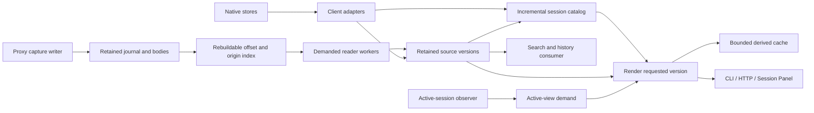

# Lazy sessions and the Rust data plane: research and migration plan

Research date: 2026-10-22. Tracking: [#263](https://github.com/inem/tap-core/issues/263).
Scope agreed for this change: investigation and a migration plan, not a runtime
implementation, installation change, or completion of the epic. All proposed
interfaces and milestones below remain unimplemented. No production state was used.

## Recommendation

Proceed with lazy rendering and incremental indexing, but separate that change
from the Hub rewrite. First stop avoidable work in the existing runtime; then
introduce an opt-in `tap-sessions` engine alongside compatibility consumers; only
replace a client after retention, output parity and rollback have passed.

Three changes to the epic's starting assumptions are necessary:

1. **Metadata is not the whole index.** Existing consumers use full-text search,
   immutable versions, graph topology, diffs and attachments. A small catalog
   cannot replace `session-index` until those responsibilities have owners.
2. **A source revision is not one file's mtime.** Work, Cursor and Antigravity
   depend on several SQLite tables/files, WALs and sometimes transcripts. Native
   sources can be overwritten or deleted. Retention remains eager where evidence
   would otherwise disappear; Markdown and timeline rendering can be lazy.
3. **One executable need not mean one failure domain.** A Rust Hub must preserve
   [#249](https://github.com/inem/tap-core/issues/249)'s separation of capture,
   page transport and consumers. A failed renderer must never change routing.

Rust is a candidate for the measured hot path, not a prerequisite for #256,
#257, #258, #259 or #262. Do not make those mitigations wait for the rewrite.
This research does not change the working stack decision in `TECHNOLOGY.md`.

## Evidence and its limits

Core inspected at `66a168a72cf2d705c41ac403f7698c704cbf9033` (`main`). The live
installation was not accessible and was not benchmarked. The CPU, RSS, PID and
FSEvents figures in #263 and linked issues are **reported live observations**;
this investigation does not independently reproduce them. In particular,
“99.9% unread”, 2–10 ms rendering and a <5 ms / <15 MB no-op are not established
performance results here.

The reproducible [research harness](../tools/check_lazy_session_assumptions.py)
uses temporary synthetic files and the existing Core reader/journal. Its
[recorded result](results/lazy-session-research-2026-10-22.json) is from Linux
x86_64, Python 3.12.14 and SQLite 3.53.1; it does not establish APFS/FSEvents or
clean-Mac behavior.

| Question | Observed result | Consequence |
|---|---|---|
| Does an idle reader write state? | After initialization: 1 checkpoint replacement and 7 `chmod` calls per `run()`. | #256 is directly reproducible on main. |
| What happens for 50 unrelated records? | 51 checkpoint writes, 7 `chmod` calls, **0 worker invocations**. | Batch progress persistence; origin indexing removes scanning work, not an already-absent filtered worker spawn. |
| Does ordinary journal resume scan the entire prefix? | At the end of 1,000 records, cursor v2 resume reads 2 lines and decodes 1, returning 0 new records. | Existing byte-offset resume already works. An origin index targets the *unread* unrelated suffix and first/replay scans. v1 compatibility differs. |
| Is directory mtime a content-change oracle? | Rewriting an existing child leaves directory mtime/size unchanged. | Watch directory membership and individual source revisions separately. |
| Is `(mtime_ns, size)` a content identity? | A same-size rewrite with restored mtime keeps that pair while bytes change. | Use it as a fast hint under declared assumptions, not as an immutable version ID. |
| Can an unchanged SQLite main file contain newer visible data? | Main-file signature unchanged; WAL changed; a new read-only connection sees the committed update. | Include WAL lifecycle and query through SQLite; never read the main file as an isolated snapshot. |

The harness asserts the filesystem/SQLite counterexamples and record/worker
outcomes. It reports current write/read counts rather than freezing inefficiency
as a future test requirement. Hard-coded scope: one segment, 1,000 legacy-format
synthetic records, one reader, a 50-record filtered batch, and one SQLite row.
It measures Python API calls, not kernel syscalls, physical disk writes or speed.

Additional source findings:

- [`Journal.scan`](../tap_core/journal.py) already validates a v2 offset anchor.
  Preserve opaque cursors, stable delivery IDs, gap reporting, replay generations
  and per-reader receipts when adding an index. Offsets are implementation detail.
- [`Reader.execute`](../tap_core/readers.py) feeds a **temporary regular file**
  as stdin. EOF is already present independently of controller death. The
  [guardian](../tap_core/guardian.py) also retains the reader lock and kills its
  process group when the parent dies. “EOF replaces guardian” is unsafe here.
- Main's [`hub.mjs`](../tap_core/hub.mjs) has the handler spawn chain and 500 ms
  bridge-revision poll, but no `recordSignal`, `signals.jsonl`, `/v1/signals` or
  `/v1/capture/live` implementation. Those require a pinned live-branch inventory
  before porting; #259 cannot be treated as a patch against this exact main.
- [`Writer.run`](../tap_core/capture.py) reports `capture.json` on its 0.5 s idle
  timeout. Fixing reader writes alone does not establish **global** zero idle
  writes. Health/heartbeat persistence needs its own bounded policy.
- The inspected observer already uses `NSWorkspace.didActivateApplicationNotification`
  in Swift `--watch`, and Python `--events` multiplexes the helper and capture
  file through kqueue with a backstop. Its server passes `--events` alongside
  `--interval 0.5`; that argument alone does not prove 2 Hz sampling in this mode.
  Audit actual mode, fallback and backstop before rewriting Stage 3. AX window
  notifications and watching the selected session are additional work.

## Source families and compatibility obligations

Sources below were inspected through connected repositories. They are format
evidence, not a license to copy private implementation into public Core. New
code must use synthetic fixtures and review provenance before publication.

| Family | Actual inputs observed in adapter source | Revision / compatibility requirements |
|---|---|---|
| ChatGPT Work | `~/.codex/state_5.sqlite`: `threads` and `thread_spawn_edges`; `thread_history_1.sqlite`: `thread_turns`/`thread_items`; per-thread rollout JSONL merged for projection lag and fork metadata. | Track both databases and WALs plus rollout revision. A rename, archive flag or parent edge can change with an unchanged rollout. Preserve turn/item IDs, ordering, exact fork/spawn edges, handoff links and explicit heuristic family hints. Cross-database reads are not automatically one atomic snapshot. |
| Codex CLI | `~/.codex/sessions` rollouts; the inspected `codex.rollouts` default branch contains only a README and says implementation is on a review branch. | Obtain that reviewed implementation/fixtures before claiming parity. Distinguish CLI/subagents from Work; do not double-count a shared underlying thread. Inventory archived/compressed sources and retention before enabling them. |
| Claude Code | Top-level `~/.claude/projects/<project>/*.jsonl`; user/assistant records with text, tool-use and tool-result blocks. | Handle appended incomplete lines, replacement, truncation and malformed complete lines explicitly. Existing adapter preserves wire-era files without `_source: disk`; do not overwrite them. Nested subagent files are a separate scope decision. |
| Cursor CLI | `~/.cursor/chats/<workspace>/<id>/store.db`: metadata and JSON message blobs. Structural branch blobs are protobuf and the current adapter skips them. | Main + WAL, read transactions, bounded blob decoding. Do not claim exact branch reconstruction where the current evidence is partial. |
| Cursor IDE | `.../Cursor/User/globalStorage/state.vscdb`: `cursorDiskKV` composer headers and separate message bubbles; `conversation-search.db` archived flags; `~/.cursor/projects/.../agent-transcripts` for tools/cwd, including subagents. | Multiple clocks and sources. A changed title/header, bubble, transcript or archived flag invalidates its dependent view. JSONL transcripts alone cannot replace this adapter. Avoid fetching every large composer value on a no-op pass. |
| Antigravity CLI | `~/.gemini/antigravity-cli/conversation_summaries.db`, per-conversation `conversations/<id>.db` (`steps.step_payload` protobuf), optional `brain/<id>/.system_generated/logs/transcript_full.jsonl`. | This differs from the epic's generic `~/.gemini/antigravity` path. Track summary metadata, conversation DB/WAL and supplemental transcript; preserve step ordering, tools, errors and text-unwrapping behavior. Hub/native formats require separate inventory. |
| Existing archive / session-index | Immutable carriers, versions, nodes/edges, attachments, transitions and scoped FTS (`dialog`, `reasoning`, `tool`, `context`, `other`). Observer also queries SQLite directly. | Import existing retained history before deleting any carriers. Preserve format capability/quality flags and latest-vs-all-version search. Migrate direct SQL consumers to a supported read interface before retiring tables/watchers. |

Reviewed source revisions (links use commit refs, not moving branches):

- [Work adapter](https://github.com/inem/tap-pack-chatgpt-work/blob/7781a0c635a44662e76ad84fc317b7ecbbe121dd/materialize_chatgpt_work.py)
- [Claude adapter](https://github.com/inem/tap-pack-claude-sessions/blob/afa0e858194030ece8f5391673399daec0949b29/materialize_claude.py)
- [Cursor adapter](https://github.com/inem/tap-pack-cursor-sessions/blob/602e4814852980a2d2c8c9373ee4a2d66acd0297/materialize_cursor.py)
- [Antigravity adapter](https://github.com/inem/tap-pack-antigravity-sessions/blob/492f2945b0865e02f452be5de0e302de2791da06/materialize_antigravity.py)
- [Codex rollout status](https://github.com/inem/tap-pack-codex-rollouts/blob/0bf6a708abcb0668ea4445af63d71bb4222616d8/README.md)
- [Session-index model](https://github.com/inem/session-index/blob/43cd4a4b7df59ade52f57af90f0a5937876c8554/README.md)
  and [implementation](https://github.com/inem/session-index/blob/43cd4a4b7df59ade52f57af90f0a5937876c8554/session_index.py)
- [Observer](https://github.com/inem/active-chat-observer/blob/de2bfbc5b5f17693eefd06b894d460421c4f5787/active_chat.py),
  [native helper](https://github.com/inem/active-chat-observer/blob/de2bfbc5b5f17693eefd06b894d460421c4f5787/foreground_window.swift)
  and [server](https://github.com/inem/active-chat-observer/blob/de2bfbc5b5f17693eefd06b894d460421c4f5787/server.ts)

## Proposed responsibility boundaries



These boxes describe ownership, not mandatory processes, repositories or one
database. Reuse the address/read/continue/replay direction in
[#245](https://github.com/inem/tap-core/issues/245); do not introduce another
universal scheduler or an incompatible cross-pack event store. Its derived-stream
contract is unfinished, so the first session slice must not pretend to implement it.

- Core owns source access primitives, bounded I/O, scheduling, catalog persistence
  and lifecycle. Client-specific decoding and semantic projections remain explicit
  adapters with their own revisions and delivery, consistent with existing packs.
  Decide their native packaging in the first Rust PR; an arbitrary Python call
  per session would simply recreate the spawn problem.
- Retention and evaluation are separate. A cache may be evicted; an only copy of
  an observed historical version may not. Follow
  [#246](https://github.com/inem/tap-core/issues/246) for full/ephemeral/narrowed/windowed
  retention and late-joiner completeness. Native current state is not an archive.
- Full-text search is a demanded maintained projection, even when no session is
  open. Retain the current search consumer until incremental FTS parity exists;
  lazily rendering Markdown does not imply lazily forgetting searchable history.
- Active view demand is an explicit subscription/lease, bounded and cancelled on
  focus loss or disconnect. There may be zero active sessions, an ambiguous title,
  or several explicit consumers. Do not treat a guessed title as a proven ID or
  make historical retention depend on focus.
- `tap-sessions` can run without the Hub or proxy. `tapd` may share Rust libraries
  but must have independently supervised page/consumer roles. The mitmproxy backend
  remains Python; neither this plan nor Stage 2 replaces its interception hooks.

## Revision, indexing and rendering design constraints

The epic's catalog tuple is a starting point, not a sufficient public schema.
Specify and fixture the following before enabling consumers:

| Area | Required behavior / proposed additions |
|---|---|
| Identity | Profile/source namespace + client/adapter + native session ID; do not key globally by an unqualified ID. Explicit duplicate/ambiguous-source handling. Separate logical session, observed version and rendered artifact. |
| Metadata | Title/timestamps/counts with quality and provenance; unknown stays null. Define whether a count means turns, messages or steps. Source mtime is not a semantic conversation timestamp. Include completeness and adapter revision. |
| Source revision | Track the dependency set, file identity/replacement, nanosecond mtime/size and last complete record boundary. SQLite main/WAL observations are wake hints; confirm logical changes in bounded read transactions. `PRAGMA data_version` is useful only on a retained connection and is not a persisted cross-restart revision. |
| Incremental JSONL | Resume at the last complete newline; retain a prefix/anchor check and source identity. Ignore only an incomplete active tail pending completion. Report malformed complete records; reset/reconcile on truncation/replacement instead of skipping bytes. First indexing still needs to parse unknown metadata/counts. |
| SQLite | Read-only connections, schema checks, bounded row queries and busy handling. Track WAL creation, truncation/checkpoint and rename. Do not use `immutable=1` on a live WAL database. If multiple sources change during assembly, retry boundedly or return an explicit inconsistent/stale result. |
| Discovery | File events trigger reconciliation, not proof of complete history. Persist membership/revision changes only; bounded reconciliation after overflow, restart, sleep/wake and deletion. Directory mtime alone cannot detect child content changes. |
| Render key | `(source namespace, logical session, source/version revision, adapter revision, renderer revision, format, options)`; the epic's `(id, mtime, format)` misses dependent inputs and code changes. |
| Cache | Optional, profile-private, byte/entry bounded, atomic publication, concurrent-request coalescing. Validate revision around render; do not publish mixed versions. No last-access write on every hit; no eager `.md`/timeline tree. A missing source returns a typed state or an explicitly requested retained version. |
| Search/history | Preserve version transitions, topology, attachment pointers, scoped search and fidelity flags. Either keep this as a separate consumer or migrate it explicitly; a title catalog is not a drop-in replacement. |

`serde_json` and `rusqlite` are sensible first candidates. Start with buffered,
bounded reads, not mandatory `memmap2`: mapping mutable/truncated sources introduces
lifetime and fault hazards, and mapping does not by itself prevent building a huge
JSON object. Add mmap only if a repeatable workload establishes its benefit and
safe source lifetime. Use SQLite's pager for live SQLite files. Pin dependencies,
license notices, toolchain and target artifacts in the implementation PR.

Proposed public entrypoints are the epic's `tap-sessions get <id> --format
md|json|timeline`, a qualified-session selector, catalog listing and loopback HTTP.
Keep them proposals until the first contract PR settles envelopes, pagination,
errors, completeness, revision/ETag semantics and timeline meaning. Existing
session-index `/v1/sessions/...` routes must be inventoried to avoid incompatible
reuse. The eventual `tap session show` should call an explicitly installed binary
or service, never an undeclared executable found on PATH.

HTTP requires profile authentication, exact origin policy for browser callers,
bounded output/concurrency and safe identifiers. Loopback binding alone is not
authorization. Local images must keep the pack's path grants, traversal/symlink
checks, MIME and 16 MiB limit; a native route must not turn a session ID into an
arbitrary filesystem read. Keep site credentials off controller routes.

## Capture index and worker protocol

The offset sidecar is a rebuildable accelerator over retained capture, not a
replacement for the journal or a new public cursor scheme. Build it in the writer
thread or a dedicated bounded indexer, never as synchronous database work on the
proxy hook. Store origin/host/path/method/status plus segment identity, offset,
length and record identity; normalize origin exactly as the existing reader does.

Publication must have an explicit **indexed-through** boundary. Publish rows only
after complete journal bytes are visible; never infer “no matching records” from
an index that is behind. On lag, defer with visible lag or use the existing scanner.
A crash after append but before index commit causes bounded tail catch-up. If an
index row references lost/truncated bytes, verify the anchor and rebuild/report a
gap. Rotation, pruning, legacy segments and a deleted/corrupt sidecar require
fixtures. Keep timestamp ordering separate from journal order; a new `seq` must
remain stable across rebuilds or remain private to an index generation. No new
power-loss durability claim follows from SQLite alone.

Do not silently feed many records to existing `python-jsonl-v1` workers: EOF/exit 0
is their completion boundary, and delivery/invocation IDs currently live in the
environment once per process. A new persistent/batch protocol must declare per-item
IDs and acknowledgements, partial-batch failure, bounded queues/output/timeouts,
cancellation and restart behavior. Advance progress only for an acknowledged
contiguous prefix; preserve uncertain outcomes and receipt-based deduplication.
Keep legacy finite workers usable until packs explicitly opt in.

Replace the guardian only after proving parent-death cleanup, descendant cleanup
and lock ownership on supported macOS. A native supervisor/event-based process
monitor is a candidate. Warm workers without bounded failure/lock behavior are
not an acceptable performance fix.

## Ordered migration slices

The ownership column names repositories/components, not assigned people. These
are proposed PR boundaries, not newly created issues or completed checkboxes.

| Slice | Owner / dependencies | Deliverable and exit gate |
|---|---|---|
| 0. Freeze evidence and inventory deployment | Core + affected packs + observer; #249 | Record deployed SHA/diff, pack versions/schedules, active helpers, source families and every archive/SQL consumer. Reproduce a frozen baseline on an isolated Mac. Recover live-only signal routes before claiming Hub parity. |
| 1. Remove avoidable existing work | Core #256/#257; Work pack #262; #258/#259 independently | Zero reader checkpoint/chmod writes on unchanged steady-state ticks; one flush per filtered batch boundary; source gates before spawn; schedules finish; Work skips unchanged dependencies. Prove failure/replay invariants. Changes can ship without Rust. |
| 2. First Rust vertical slice | Core `tap-sessions` + Work/Claude adapters; depends on source/retention fixtures | CLI catalog + lazy md/json/timeline over explicit roots, no default watcher. Start with Claude's file source, then Work's DB/rollout join. Compare with frozen existing adapters, including tools, branches and projection lag. Include lockfile, bounded cache, cold/warm benchmarks and packaged test artifact. Do not call all Stage 1 done. |
| 3. Complete native source coverage | Cursor and Antigravity packs; Codex rollout reviewed branch | Separate adapters/fixtures for each family above, including WAL-only changes, title/archive-only changes, protobuf, partial formats and deletion. Each adapter cutover is independent and gated by parity. |
| 4. Migrate consumers | Session-index, session-strip, tapout-cli, active-chat/Session Panel | Versioned read boundary and local HTTP; catalog/FTS/history responsibilities preserved; switch consumers from directory scans/direct SQL. Explicit file exports for consumers that still require files. Only then stop their old materializers/watchers. |
| 5. Add indexed capture access | Core capture/journal; #245/#246 semantics | One rebuildable sidecar and indexed origin queries with verified ranges, crash/rotation/retention parity and lag visibility. Run old scanner as a comparison oracle, then switch readers. No cursor reset or silent gap removal. |
| 6. Worker and Hub migration | Core + opted-in packs; #255/#258/#259; #249 lifecycle separation | Versioned persistent/batch protocol, bounded supervision, then Rust Hub protocol/auth/page-command parity. Reuse current Python/Bun implementation as oracle; remove Bun from required delivery only after every used route/resource has a replacement. |
| 7. Complete event-driven active view | active-chat-observer #32; session change subscription from slice 4 | Extend existing notifications to window/title changes and selected-source changes; coalesce bursts; explicit fallback on missing AX/events. Stop periodic session-index and session-strip spawns; throttle hidden UI. Test focus ambiguity, permission loss, sleep/wake and helper restart. |

Slices 5 and 7 can proceed alongside source coverage once their contracts exist.
“Highest ROI” is provisional until slice 0 produces comparable traces: #256 has
direct evidence of unnecessary writes, but no cross-client speedup ranking was
measured here. Avoid bundling all seven slices into a single rewrite PR.

## Cutover and rollback

For **each client and consumer**, record old producer/version, new producer/version,
source roots, retained-history policy, dependent consumers, verification result and
rollback command before activation:

1. Inventory and back up required immutable carriers and databases consistently
   (including SQLite WAL state). Do not delete the old archive/index as a cache.
2. Run the new engine in a separate profile/cache/database against read-only
   source fixtures or an explicitly authorized snapshot. Compare semantic output,
   versions, errors and resource costs. Time-box shadow operation to avoid doubling
   the very workload this migration removes.
3. Switch one consumer to the new endpoint/CLI. If a consumer still requires files,
   use an explicit compatibility export; a symlink cannot lazily materialize bytes
   on read. No FUSE dependency is proposed.
4. Disable only that client's superseded scheduler/reader/LaunchAgent after its
   consumers pass. Ensure one owner per derived output; do not let old and new
   producers mutate the same database or directory.
5. Roll back by stopping the new role and restoring the recorded producer and
   consumer bindings. Keep old schemas intact; use separate versioned state for
   migrations. Resuming requires verifying source retention and saved cursors;
   a lost prefix is a visible gap, not an automatic reset.
6. Retire compatibility artifacts only after all named consumers have migrated
   and history has another verified owner. Archive deletion is a separate explicit
   operation, not part of enabling lazy mode.

Installation must deliver pinned arm64/x86_64 macOS artifacts and license notices;
the user must not need Cargo. Validate install/update/rollback/uninstall and the
existing `tap on/off/status/doctor/where` behavior. `tap status` should distinguish
capture health, page transport, source/index lag and consumer failures. Fail a
consumer or Hub deliberately and verify routing/capture remain unaffected (#249).

## Acceptance experiments for implementation

Use deterministic synthetic corpora in CI and an authorized frozen corpus for
semantic replay. Never use the live archive as writable test state. Record commit,
adapter versions, corpus digest, source size/count, OS/CPU/filesystem, cache state,
concurrency, executable build mode and instrumentation with every measurement.

| Scenario | Required result |
|---|---|
| No source changes | After initialization: zero source body reads/parses, zero derived/cache/checkpoint writes and zero child spawns attributable to session indexing; count metadata stats separately. Measure observer and capture heartbeat writes separately. |
| Append one turn | Work proportional to the appended JSONL suffix or affected SQLite session, not all historical sessions; correct new count/revision and no unrelated render. |
| Rewrite / WAL-only commit / rename / archive change | Correct dependency invalidation even if rollout mtime is unchanged; no mixed-source version published. |
| Partial/malformed/oversized input | Incomplete tail waits without advancing past it; complete corruption and size/decode failures are visible; bounded memory and retries. |
| Repeated/concurrent get | Same revision/output, coalesced work; no write on cache hit; bounded cache eviction; renderer/adapter upgrade invalidates old entries. |
| Historical retrieval/search | Existing versions/forks/tool content/attachments and scoped latest/all-version search remain available with honest capability flags. Source deletion does not masquerade as an empty session. |
| Journal/worker failures | Torn append, index lag/crash/corruption, rotation, retention gap, replay, duplicate delivery, partial batch, timeout and killed supervisor preserve IDs/progress and prevent overlapping effects. |
| Active-view events | Same-app window/title changes, rapid focus, unavailable AX, helper crash, sleep/wake and watch overflow produce correct state or explicit unknown; no perpetual helper spawns. |
| Lifecycle | Hang/kill Hub and consumers without changing capture/routing; restart, update rollback and clean-Mac install pass independently of fixture tests. |

Measure p50/p95/p99 for discovery, resident no-op pass, cold process startup,
uncached render, cached get and event-to-visible-update separately. Report peak RSS,
CPU time, bytes read/written, spawn count, logical state updates and on macOS actual
FSEvents/idle wakeups. Use several source sizes (1k/10k sessions, small/large and
oversized records) and repeated warm runs; a single median is not an SLA.

Treat the epic's <5 ms / <15 MB no-op and 2–10 ms rendering as **targets to test**.
Define the workload and response-size bound before making them pass/fail gates:
rendering an arbitrarily large session cannot have constant latency or memory.
The existing capture limit alone permits a 32 MiB record, already larger than the
proposed 15 MB whole-process budget. Keep indexer, renderer and capture budgets
distinct. Native stat calls across thousands of cold files are not free; event
coalescing and changed-source indexing matter more than a language-only promise.

## Verification of this research change

```sh
python3 tools/check_lazy_session_assumptions.py \
  --output docs/results/lazy-session-research-2026-10-22.json
PYTHONPATH=tests:. python3 -m unittest \
  test_readers.ReaderTests.test_controller_crash_keeps_lock_until_child_exits \
  test_readers.ReaderTests.test_guarded_controller_crash_releases_lock_only_after_worker_cleanup -v
git diff --check
```

The harness passed and recorded the results above. The two existing controller
crash tests did **not** pass in this Linux container: the unguarded CLI fixture
never starts its worker because the CLI rejects non-macOS hosts (`This extraction
currently supports macOS only`); the guarded fixture reaches its PID-disappearance
assertion, but killed orphan Python processes remain zombies under container PID 1.
These are recorded verification limits, not a passing macOS supervision check.
No production change was made to make these tests pass. The process-cleanup gate
must be rerun on supported macOS before replacing the guardian.

No new runtime API, source adapter, cache or daemon is implemented.
Mac performance, live-branch reconciliation, private adapter parity,
signed delivery and clean-machine acceptance remain open; #263 must stay open.

Affected [review lenses](review-planes.md): source/consumer dependencies;
Core versus client responsibility; retention/progress/process ownership; read
authority and uncertain effects; independent delivery/rollback; fixture versus
live evidence. The proposed scopes above do not waive the epic's unmet criteria.
